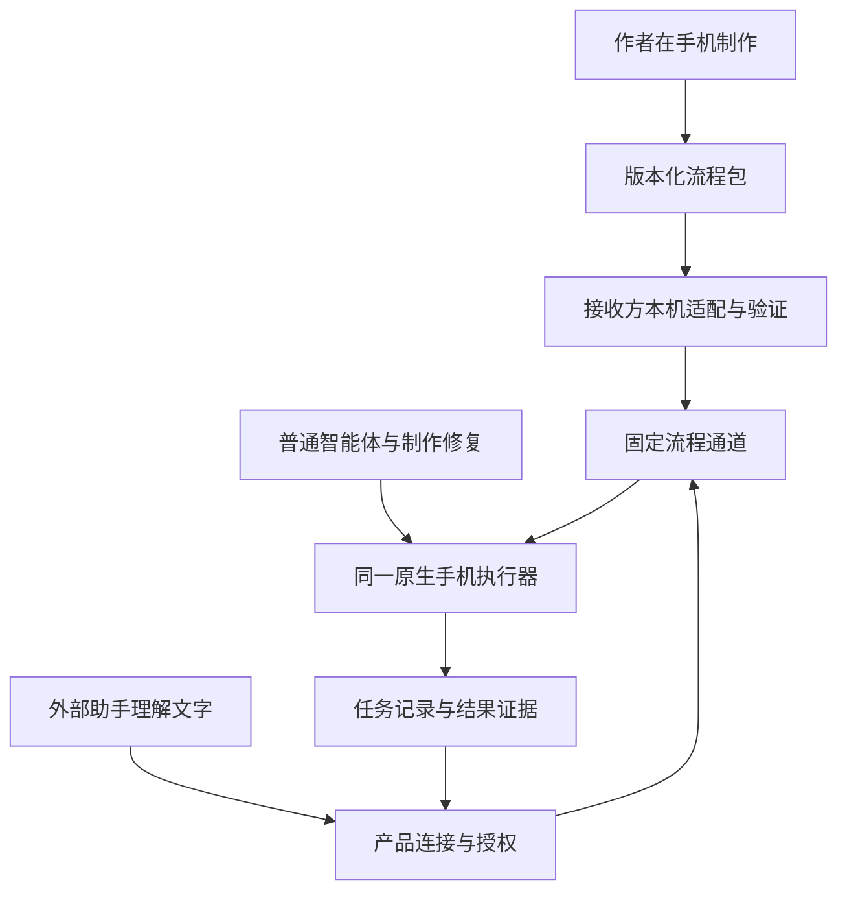

# BKSOP（安卓自动化产品）完整需求文档

文档编号：需求001；文档版本：1.0（详细草案）；总纲版本：0.1。
确认状态：总纲已确认；本详细文档待审，不代表功能已经实现。
确认依据：用户在本对话明确表示“认可，请继续制定详细的 PRD”（产品需求文档），未提出总纲范围变更。
编写日期：2026年11月2日，北京时间。

资料覆盖：本对话可见需求、025c0180f5c528571d85d4f58fa78fcace5e4470（已提交总纲版本）中的项目文件，以及实际读取的技能与源码。未找回的历史二开代码不作为实现证据。
本文中的“必须”“应当”描述交付要求；源码现状、待实现内容、文档检查和产品实测分别记录。九项产品验收当前均未执行。

## 总纲镜像

以下为已确认的独立总纲原文。仅将确认状态由“待确认”更新为“已确认”，目的、技术栈、功能和验收正文保持不变。

<!-- 总纲开始 -->
# BKSOP（安卓自动化产品）需求总纲

版本：0.1；确认状态：已确认。

## 一句话目的

让流程作者和使用者在安卓手机上完成通用自动化流程的制作、分享、本机适配与固定执行，并通过外部大模型的对话调用已验证的流程，减少重复人工操作和内部模型消耗。

## 技术栈

- 语言：Kotlin（安卓开发语言），沿用[现有应用构建配置](https://github.com/beyondchenlin/BKSOP/blob/4890bdefe433cac3ecbc2caa0ed3b26ee1fb6e4c/app/build.gradle.kts)。
- 仓库：复用 [BKSOP（项目仓库）](https://github.com/beyondchenlin/BKSOP)，基于 MIKA（开源手机智能体）持续二开，隔离官方镜像、开发与发布分支。
- 界面：沿用 Jetpack Compose（安卓原生界面框架）和原有聊天界面。
- 执行：制作调试与固定运行共用原生手机执行器，不新增第二套自动化执行框架。
- 数据：复用本机持久化与 JSON（结构化数据格式）序列化，分别保存流程、设备绑定、适配记录与任务结果。
- 外部连接：使用 MCP（模型上下文协议）提供工具接口、Skill（技能）提供调用说明；手机连接、设备授权和远程通信由产品内置管理。

## 功能清单

- 功能01：**保留原有通用能力。** 保留原项目的普通智能体、对话、模型配置及已有手机自动化能力，在同一个应用中增加可复用流程功能。视频发布只是一个示例，其他自动化流程继续使用同一套通用能力。

- 功能02：**在手机上制作并固化流程。** 作者通过描述需求、运行和调试，把已跑通的操作保存为具有明确输入、动作、条件和成功判据的流程版本。制作及修复允许模型参与；日常使用者无需重新编写操作步骤。

- 功能03：**分享、导入和管理流程。** 作者可以导出流程包，接收方可以导入、查看说明、管理版本、启用或停用。分享包不夹带作者的账号凭据、私有素材或不可迁移的本机绑定；导入后不自动执行，运行中的任务不自动切换流程版本。

- 功能04：**在接收方手机上适配、验证并定版。** 接收方使用自己的账号、权限和资源，处理设备、系统及目标应用界面的差异，通过验证后启用。测试范围与真实业务结果分开记录；测试中已经完成的真实业务动作不能在正式运行时重复提交。超出已验证的兼容条件时重新验证。

- 功能05：**按参数固定执行，控制模型消耗。** 已固化流程直接接收明确参数，正常执行及程序处理的失败路径不调用内部模型。需要模型介入时单独进入修复模式并记录用量，不在固定任务中静默增加模型调用；外部助手理解需求的用量仍按其产品规则计算。

- 功能06：**通过外部助手对话调用手机流程。** 用户用文字表达目标和内容要求，由外部助手生成文案及标准参数，发现、启动并查询本人授权手机上的已启用流程，也能处理等待事项和停止任务。豆包工作、WorkBuddy（腾讯办公助手）作为接入验证对象；正式支持的具体手机入口须经真实联调确定，不能只凭技能文件存在就标为可用。

- 功能07：**提供现成视频的多平台发布示例。** 根据唯一名称、指定相册、排序与数量条件在本机定位并固定素材，按照外部助手给出的文案填写和发布。模型不理解视频内容，不把视频、视频帧或缩略图交给模型分析；素材上传由目标平台客户端完成。本次示例包含抖音、快手；其他平台名单待确认。视频剪辑、视频内容理解，以及新开发的语音选材、定时发布交互不纳入本次新增范围。

- 功能08：**管理任务状态、异常与恢复。** 用户能查看进度、结果、失败原因和等待事项，并按当前状态继续或停止。重复请求不重复执行，成功子任务不重做，提交结果不明确时先核查；同一手机的界面操作排队。手机离线、权限不足、素材歧义和无法定位页面时返回明确状态，不伪报成功。

- 功能09：**交付可安装使用的安卓产品。** 提供以 BKSOP（产品名称）命名、具有独立应用身份与签名的 APK（安卓安装包），完成安装、启动和目标流程的实机验收，并附支持的设备、系统及应用版本清单。用户在手机上完成安装、授权、登录、绑定和日常使用，无需电脑，也无需另装 AutoJS（安卓自动化脚本工具）、Linux（操作系统）环境或独立桥接程序。

## 验收标准

- 验收01 → 功能01：安装二开版本后，在同一应用中完成已选定的原有对话与手机操作回归用例，并运行一条非视频流程；原有能力被替换、失效，或通用流程被强制要求填写视频字段，均视为未通过。

- 验收02 → 功能02：作者仅使用手机制作一条流程，保存后退出并重新打开，流程版本、参数和操作规则仍在；更换一组合法参数后可以执行对应任务。依赖电脑、只能重播写死的数据或保存后丢失，均视为未通过。

- 验收03 → 功能03：作者导出流程，另一用户导入后能查看版本与要求，并绑定自己的账号和资源；检查分享包不含作者的私有数据。导入即自动执行、使用作者凭据，或任务中途被升级替换，均视为未通过。

- 验收04 → 功能04：在至少两台不同型号的安卓手机上，分别完成同一流程的适配和验证，并保存各自结果；未验证或兼容条件失效的流程不能正式运行。提交前测试不得产生真实发布，已明确执行过的真实测试结果不得再次提交；任何一项不满足均视为未通过。

- 验收05 → 功能05：对正常固定任务及可由程序处理的异常任务检查调用记录，内部模型调用次数必须为零；进入智能修复后必须单独记录修复及用量。存在隐藏模型调用、把外部请求重新交给内部模型理解，或修复调用记录缺失，均视为未通过。

- 验收06 → 功能06：至少在一个选定外部助手的手机使用入口，完成文字描述、参数生成、授权调用、手机执行和结果回传的完整测试，并核验其只能访问获授权设备。未连通实际手机、只有模拟结果、需要用户改用电脑才能完成，或未经验证就宣称支持某个入口，均视为未通过。

- 验收07 → 功能07：使用三段预先命名的测试视频，在抖音、快手分别完成发布，六个子任务均选中正确素材、填写正确文案并取得结果证据；记录证明没有把视频内容交给模型分析。运行中新增文件不得改变已固定清单；重名、缺失或素材身份无法确认时必须停止对应操作。错选素材、重复发布或无证据报成功，均视为未通过。

- 验收08 → 功能08：测试重复请求、断线重连、部分失败、继续、停止及提交后结果丢失，任务记录必须与实际动作一致；成功项不重做，过期继续指令不推动新步骤，停止后不再发起后续动作，未知结果先核查。重复产生业务效果、界面争用或状态失真，均视为未通过。

- 验收09 → 功能09：从正式交付地址下载安装包，在兼容清单中的手机完成安装、启动、必要设置和“导入—本机验证—外部调用—结果反馈”全链路，并提供对应构建和实机记录。包名、产品名称、签名与更新来源须对应本产品；仅有源码、文档、构建成功记录或接口已接收响应，均不能代替实际可用验收。

<!-- 总纲结束 -->


## 技术栈说明

### 已确认的技术选择

| 层面 | 本项目采用的方案 | 实现约束 |
| --- | --- | --- |
| 语言与应用 | Kotlin（安卓开发语言），复用现有安卓应用 | 继续维护同一产品代码基础，不另起一套手机应用 |
| 界面 | Jetpack Compose（安卓原生界面框架）与原有聊天界面 | 原有入口保留；新增流程、验证、任务和外部连接页面 |
| 手机动作 | 原生统一执行器 | 普通智能体、制作修复及固定流程共用动作能力；新增的是固定运行通道，不是第二套自动化框架 |
| 本机数据 | 现有文件持久化基础与 JSON（结构化数据格式）序列化 | 共享流程、安装绑定、验证、运行记录分别建模；原子保存与格式版本校验 |
| 外部工具 | MCP（模型上下文协议）及 Skill（技能）调用说明 | 工具负责真实执行，技能说明负责正确选择、填参和读取结果 |
| 手机连接 | 复用手机主动连接的原生远程通信基础 | 产品管理配对、调用方授权、设备归属和结果回传，不要求用户另装桥接程序 |
| 分支 | 纯上游镜像、二开开发、验证后发布三轨 | 文档和二开代码进入开发分支；镜像中不加入定制，未经验证不提升发布分支 |

构建工具、依赖版本和最低系统要求以锁定基线的构建文件为准；不在本需求中擅自更换语言、界面框架或增加数据库服务。新增流程存储沿用已确认的本机持久化方向，具体文件布局属于实现细化，不是重新选择技术栈。

### 实际代码基础与新增工作

截至本次读取，开发分支相对官方0.1.33版仅新增文档，业务源码未发生二开变化。以下事实用于判断复用边界，不能列为九项需求已经完成。

| 已有基础 | 已核实的限制 | 本需求要求新增或完善的内容 |
| --- | --- | --- |
| 原生连续手机操作及统一动作入口 | 连续操作工具不等于带版本、验证和任务账本的共享流程 | 在同一执行器上增加参数化固定流程通道 |
| 经验路线选择与回放 | 选择路线会调用模型，回放结束或偏离后交还模型 | 明确流程版本直达执行，模型请求前强制拦截 |
| 路线文件存储 | 当前学习缓存会淘汰旧记录，读取失败会删除文件 | 用户保存的流程独立持久化，损坏隔离、可恢复，不按学习缓存策略删除 |
| 原运行记录 | 记录原智能体运行，并不证明已有工作流安全续跑 | 增加请求去重、固定资源、子任务结果和副作用检查点 |
| 手机主动连接远程网关 | 已有说明按单用户、单设备设计；工具兼容还受授权方式限制 | 增加真实的调用方、设备、流程授权及手机宿主联调 |
| 应用构建与更新机制 | 品牌、包名和更新源仍属于原项目 | 完成独立品牌、应用身份、签名和更新链路 |

依据见本文“需求来源与决定记录”中的源码索引。已有内置运行环境作为原能力保留；“无需另装环境”不等于删除原应用内置能力。

### 运行关系



外部模型决定本次业务参数，手机普通程序决定已经固化的步骤怎样执行。固定通道不把参数再次转成自然语言目标交回原智能体。通信服务是产品交付的一部分；手机用户不承担部署服务、维护电脑或开公网入站端口的工作。

## 背景、目标与边界

### 使用者与核心问题

| 使用者 | 需要解决的问题 | 交付后应获得的结果 |
| --- | --- | --- |
| 流程作者 | 每次重新操作和调试，经验无法稳定交给别人 | 在手机上将成功操作整理成可分享、可传参的流程版本 |
| 流程接收者 | 手机型号、权限、账号和应用界面与作者不同 | 在自己的手机上完成适配和验证，之后按参数重复使用 |
| 外部助手使用者 | 希望继续用熟悉的对话入口表达需求 | 外部助手生成参数并调用手机，取得真实结果，无需逐次编写脚本 |
| 产品维护者 | 上游持续更新，定制易混入官方代码 | 通过明确分支、兼容记录、测试和发行资料维护同一产品 |

核心目标是通用流程的可复用性、跨设备适配、固定执行和对话调用。视频发布验证这些通用能力，标题、标签、平台、相册均属于示例参数或适配规则，不能变成所有流程的必填字段。

### 本次交付范围

交付范围完整覆盖功能01至功能09，包括原能力回归、手机制作、分享导入、本机适配、固定运行、至少一个外部助手的手机入口、抖音与快手视频示例、运行可靠性和真实安卓安装包。

本次新增范围不包含视频剪辑、视频内容理解、新开发的语音选材、定时发布交互、公开流程市场、付费订阅或团队协作平台。此处的排除不删除原项目已经存在的能力。除抖音、快手外的平台仍待确认，不能自动扩展成“六个平台已经承诺支持”。

不承诺任意手机、任意目标应用版本、锁屏状态或被系统强行停止后的无人值守执行。支持范围必须由实际手机测试确定。外部助手免费额度仍属于外部产品，不能作为本产品可任意调用的免费模型接口。

### 成功与失败的判定原则

- 配置保存、服务收到请求、手机接收任务、动作执行、业务成功是不同事实，界面和工具结果必须分别表达。
- 页面点击完成不等于发布成功；业务成功需要该流程声明的结果证据。
- 固定任务的内部模型调用为零，不等于整个产品或外部助手没有模型用量。
- 流程导入成功不等于本机验证通过；提交前验证通过不等于真实发布成功。
- 文档、结构检查、代码测试、安装包构建和实机验收分别记录，不相互替代。

## 需求来源与决定记录

### 用户需求与确认

| 来源定位 | 已明确的决定或约束 | 对应功能与验收 | 状态 |
| --- | --- | --- | --- |
| 本对话中用户说明“上传素材到不同的平台”只是小功能，后续还要其他自动化 | 通用能力保留，视频仅为示例 | 功能01、功能02、功能07；验收01、验收02、验收07 | 已纳入已确认总纲 |
| 本对话中用户反复要求全程在手机上开发、测试、调试和运行 | 作者与接收方使用流程不能依赖电脑 | 功能02、功能04、功能09；验收02、验收04、验收09 | 已确认 |
| 本对话中用户要求作者分享给其他用户，各自在自己的手机上先跑通 | 分享模板与本机适配分离，验证后启用 | 功能03、功能04；验收03、验收04 | 已确认 |
| 本对话中用户要求外部助手理解文字、生成文案，手机只执行固定流程 | 外部理解与本机固定执行分工 | 功能05、功能06；验收05、验收06 | 已确认 |
| 本对话中用户强调只定位已命名的视频，不上传给模型理解 | 本机资源定位，禁止视频分析，目标客户端最终上传 | 功能07；验收07 | 已确认 |
| 本对话中用户要求产品与安装包命名为本产品，并询问下载安装使用 | 实际可用的独立安卓交付 | 功能09；验收09 | 已确认 |
| [总纲0.1的原始提交](https://github.com/beyondchenlin/BKSOP/blob/025c0180f5c528571d85d4f58fa78fcace5e4470/docs/prd/001-mobile-workflows/总纲.md) | 固定九项功能、九项验收和技术栈 | 功能01至功能09；验收01至验收09 | 本轮用户已确认 |
| 用户本轮“认可，请继续制定详细的 PRD”（产品需求文档） | 确认上一版总纲，并授权展开详细文档 | 全部条目 | 已确认；不提前认定详细正文或产品已验收 |

两台不同型号手机、至少一个外部助手手机入口、三段视频在两个平台形成六项结果，均已写入被确认的总纲，本详细文档不降低这些条件。

### 已读取的项目与源码依据

下列源码链接均固定在详细文档编写前的已核对提交，避免把后续变化混入当前事实。

| 依据 | 对本需求的意义 |
| --- | --- |
| [项目开发规范](../../../AGENTS.md)与[既有架构设计](../../bksop/WORKFLOW_DESIGN.zh-CN.md) | 三轨分支、统一执行器和通用共享流程设计 |
| [原生连续手机操作](https://github.com/beyondchenlin/BKSOP/blob/025c0180f5c528571d85d4f58fa78fcace5e4470/core/src/main/kotlin/com/wangzan101/mika/core/cap/phone/PhoneRun.kt) | 复用现有手机动作入口，不能把连续操作工具当完整流程产品 |
| [路线选择](https://github.com/beyondchenlin/BKSOP/blob/025c0180f5c528571d85d4f58fa78fcace5e4470/core/src/main/kotlin/com/wangzan101/mika/core/replay/RouteMatcher.kt)及[回放接续](https://github.com/beyondchenlin/BKSOP/blob/025c0180f5c528571d85d4f58fa78fcace5e4470/core/src/main/kotlin/com/wangzan101/mika/core/agent/RouteReplay.kt) | 已有回放仍有模型调用与读屏送模型路径 |
| [路线文件缓存](https://github.com/beyondchenlin/BKSOP/blob/025c0180f5c528571d85d4f58fa78fcace5e4470/app/src/main/java/com/wangzan101/mika/replay/FileRouteStore.kt) | 共享流程不能照搬会淘汰或删除损坏文件的缓存生命周期 |
| [远程连接说明](https://github.com/beyondchenlin/BKSOP/blob/025c0180f5c528571d85d4f58fa78fcace5e4470/docs/dev/remote-mcp.md) | 手机主动连接可复用，单用户设备范围及宿主授权兼容仍需产品化 |
| [项目与更新地址](https://github.com/beyondchenlin/BKSOP/blob/025c0180f5c528571d85d4f58fa78fcace5e4470/app/src/main/java/com/wangzan101/mika/about/MikaLinks.kt)及[安装包完整性校验](https://github.com/beyondchenlin/BKSOP/blob/025c0180f5c528571d85d4f58fa78fcace5e4470/app/src/main/java/com/wangzan101/mika/about/ApkIntegrity.kt) | 更新地址与下载校验应随独立产品身份一起调整 |
| [应用构建配置](https://github.com/beyondchenlin/BKSOP/blob/4890bdefe433cac3ecbc2caa0ed3b26ee1fb6e4c/app/build.gradle.kts) | 已确认语言、界面基础及原构建方式 |
| [需求文档技能](https://github.com/oceans777/prd-skill/blob/5e5ed4c542553174cc7f8efe94d836dc57794eae/SKILL.md)与[审查规则](https://github.com/oceans777/prd-skill/blob/5e5ed4c542553174cc7f8efe94d836dc57794eae/references/审查规则.md) | 总纲确认、逐项展开、镜像一致与两轮审查 |

## 详细功能

### 功能01 保留原有通用能力

**总纲对应：**保留普通智能体、对话、模型配置和已有手机自动化，在同一应用中增加可复用流程；视频仅为示例。

**使用者与前置条件：**所有产品用户。已有原生能力按其真实权限和配置条件使用；没有配置模型或没有系统权限时，说明缺少什么，不以空按钮代替功能。

**输入与主流程：**

1. 用户打开应用，仍能进入原有聊天和设置。
2. 用户可以继续向普通智能体提出通用任务，也能进入“我的流程”管理已保存流程。
3. 普通对话与固定流程使用同一份设备能力和手机动作执行入口，分别保持自己的任务记录。
4. 以一条非视频流程验证通用机制，例如打开指定应用、填写明确文本并读取指定页面状态。该用例只依赖自己声明的参数。

**输出和可观察行为：**原有对话、配置和已选回归能力可用；新增流程入口和任务入口清晰，用户知道当前是普通智能体还是固定流程模式。

**边界、失败与恢复：**固定通道的模型限制不应禁用普通智能体的模型能力。原有配置读取失败时显示原因并保护原数据，不通过重建空配置伪装修复。非视频流程不得要求填写视频路径、标题或发布平台。

**权限、保真与兼容：**新增权限不得成为使用原有无关能力的统一前提。保留原有许可、署名和依赖声明。原产品到独立新应用的跨包名数据迁移未列入本次承诺，不能声称会自动继承另一应用的私有数据。

**实现说明：**复用现有原生界面、能力注册和执行器。普通智能体与固定通道分别定义入口及运行上下文，不能复制一套点击、输入或权限管理实现。所有会控制前台页面的入口都参加同机界面排队。

### 功能02 在手机上制作并固化流程

**总纲对应：**作者通过描述、运行和调试，把已跑通操作保存为有输入、动作、条件、成功判据和版本的流程；制作修复允许模型参与。

**使用者与前置条件：**流程作者。已具备本次目标应用、账号和必要系统授权；使用模型制作时已配置可用模型。

**输入：**用户文字目标、目标应用、本机资源、可变化的参数，以及这条流程要完成到什么业务状态。敏感绑定由手机管理，不写入共享模板。

**主流程：**

1. 作者在现有聊天入口描述需求并完成一次目标流程，或继续修改已保存草稿。
2. 作者选择将这次做法保存为流程，填写可识别名称与用途说明。
3. 系统将动作整理成可核对的步骤、条件和成功判据，识别需要替换为参数或本机绑定的值。
4. 作者在手机上核对输入参数、涉及应用、业务效果和测试范围；未能形成明确规则的步骤保持草稿状态。
5. 使用不同的合法参数再验证，确认不是只复现第一次的固定内容。
6. 保存新流程版本。编辑已发布版本时产生新版本，旧版本继续可追溯。

**输出：**草稿或不可变流程版本，包含名称、说明、参数规范、动作及分支、资源槽位、等待条件、成功判据、效果类型和恢复规则。

**关键规则：**

| 项目 | 要求 |
| --- | --- |
| 参数 | 有名称、类型、必填性、约束和说明；未知参数或类型错误在执行前拒绝 |
| 定位 | 优先使用页面和控件可验证属性；坐标或序号只作为本机适配的一部分 |
| 条件 | 动作前确认正确应用和页面，动作后核对预期变化 |
| 副作用 | 每个动作声明是否会发布、发送、修改或删除业务数据，不能只标最后一步 |
| 成功 | 声明可观察证据；不能以“模型说完成了”作为固定任务的唯一判据 |
| 保存 | 保存成功后重开应用仍可读；写入失败不显示已保存 |
| 版本 | 版本内容与摘要绑定，不在同一版本号下静默替换动作 |

**失败与恢复：**定位模糊、参数未声明、未知动作能力或缺少成功判据时不固化为可启用版本。模型生成的步骤只是候选，须通过程序校验与本机验证。修复保留原版及失败位置，不能覆盖正在运行的任务版本。

**实现说明：**现有路线记录和原生动作提供制作材料，但要形成显式流程对象。不得直接导出整个聊天历史或运行缓存；也不得把作者输入过的密码、访问令牌或个人文件位置作为默认共享参数。

### 功能03 分享、导入和管理流程

**总纲对应：**导出、导入、查看说明、管理版本、启停；不夹带作者私有数据，导入不执行，运行版本不自动变化。

**使用者与前置条件：**作者与接收方。导出对象为已保存的流程版本；接收方安装本产品并能访问用户选定的流程文件。

**导出流程：**

1. 作者选择明确版本，查看用途、参数、所需能力、涉及应用和业务效果。
2. 系统从可共享对象生成流程包，不从整个应用数据目录打包。
3. 作者的账号、授权、素材引用、验证记录和临时会话绑定被替换为接收方必须填写的本机槽位。
4. 导出文件通过系统文件保存或分享入口交给接收方。

**导入流程：**

1. 接收方从手机文件或系统分享入口打开流程包。
2. 系统校验格式、版本、摘要、参数规范、动作能力及支持限制。
3. 显示流程说明、版本、所需能力、业务效果和缺少的本机条件。
4. 用户导入后创建本机安装记录，状态为“待适配”，不启动任何业务动作。
5. 完成本机验证后可以启用；停用后禁止新任务使用该安装记录。

**版本与状态规则：**

- 相同流程、相同版本、相同内容再次导入，复用安装记录并显示已存在。
- 相同流程与版本但内容不同，标记版本冲突并拒绝静默覆盖。
- 新版本作为独立候选，旧版和旧验证记录保留；新版本验证后再切换启用。
- 运行创建时固定流程版本、适配版本和参数快照。导入新版、停用或切换默认版本不篡改已创建任务。
- 停用表示不再接受新任务；用户要终止已运行任务，使用明确的停止操作。

**权限与保真：**共享包的摘要用于完整性校验，不代表发布者可信。包中只能引用当前执行器已注册、可授权的能力，不能通过导入绕过应用权限或添加任意执行权限。对未声明可共享的捕获内容，不自动带出手机。

**失败与恢复：**损坏、未知格式、超出已声明大小限制或缺少运行能力时，显示具体原因并保持现有安装不变。保留用户原始导入文件；解析失败不能自动删除用户保存的流程。

**实现说明：**按本机持久化和结构化序列化实现独立流程库。流程包格式版本与产品版本分开；未来升级须有明确迁移规则，不能复用现有学习缓存的自动淘汰与删除损坏记录策略。

### 功能04 在接收方手机上适配、验证并定版

**总纲对应：**使用接收方自己的账号、权限和资源适配，在不同设备上验证后启用；真实测试不重复提交，兼容条件失效时重新验证。

**使用者与前置条件：**接收方。流程已导入，所需目标应用已安装；手机能够完成该流程所需的授权与登录。缺少条件时显示可操作的本机引导。

**主流程：**

1. 检查目标应用版本、手机环境、流程能力和权限。
2. 用户绑定自己的账号、相册、目录或其他资源，系统保存本机映射。
3. 进入验证模式，逐步检查页面定位、参数填写、资源选取和等待条件。
4. 每个会产生真实业务效果的动作都进行测试边界检查，不能只在最后一步检查。
5. 只读步骤及明确可恢复的本机准备动作按测试规则执行；未经明确授权的发布、发送等业务动作停在效果发生前。
6. 记录实际验证到的范围、通过与失败项，处理设备差异后重新验证受影响部分。
7. 验证满足本机启用条件后定版；真实业务效果在正式任务或明确授权的真实测试中取得证据。

**验证结果必须区分：**

| 结果 | 能证明什么 | 不能冒充什么 |
| --- | --- | --- |
| 前置条件通过 | 权限、应用、账号和资源满足当前条件 | 尚未证明操作路径正确 |
| 本机适配通过 | 实际检查过的页面、定位、填参与提交前路径可用 | 尚未证明未执行的发布动作成功 |
| 实际效果已验证 | 对应业务动作已真实执行并取得证据 | 不自动证明其他平台、设备或后续版本可用 |

**最低启用条件：**参数规范和动作规则校验通过；本机账号、权限、资源及兼容版本有效；所有拟启用分支的提交前路径与定位已验证；会产生业务效果的动作已声明授权范围、派发前检查、结果核验和未知结果处理规则。仅有权限检查不能启用。已经满足这些条件，但尚未真实执行的业务效果明确标为“未实测”，不伪装成发布成功。用户首次明确授权的正常业务任务可以补齐实际效果证据，无须为启用流程额外发布一次。未覆盖的分支或不满足上述条件的输入范围不得在本次安装中启用。

**兼容条件：**验证记录绑定流程内容摘要、本机适配版本、设备环境、目标应用版本和相关账号/资源绑定。明确的版本或定位规则变化超出记录范围时，状态改为“需要重新验证”，不能把旧结果直接套用。

**真实测试去重：**一次明确授权的测试若已经发布成功，该结果进入同一业务任务账本。后续正式执行只继续尚未完成部分，不能为了“正式版本”再发一次。需要再次发布同样内容时，必须属于用户明确发起的新业务任务，而不是隐式重试。

**失败与恢复：**权限问题、账号问题、页面定位问题分别报告。适配失败停在失败位置，不继续猜点。智能修复属于独立制作修复任务；修复形成新适配或新流程版本，原任务保留原版和已完成记录。

**实现说明：**重用原生定位与动作检查，但新增本机安装、环境校验和验证报告。接收方改变本机适配不修改作者或其他接收方的绑定。

### 功能05 按参数固定执行，控制模型消耗

**总纲对应：**固定任务及程序处理的异常不调用内部模型；修复另行进入并记录；外部助手用量按外部产品规则计算。

**使用者与前置条件：**在手机内运行流程的用户，以及通过已授权工具调用的外部助手。必须提供启用的流程版本、合法参数和可识别的请求编号。

**固定运行主流程：**

1. 校验调用身份和设备归属，先检查原请求是否已存在；已存在且内容一致时返回原任务，内容冲突时拒绝修改。仅对新请求继续验证启用状态、流程版本、本机安装、兼容条件和参数。
2. 创建持久运行记录，固定适配和规范化参数；本机资源解析完成后原子保存清单，后续步骤不得再次按“最新几个”重新选材。
3. 获得同机界面执行权后重新检查当前权限、账号、兼容条件与停止状态；通过后进入原生固定流程通道，不能沿用排队前已经失效的检查结果。
4. 依据显式条件执行动作、等待和确定性分支，逐步写入检查点。
5. 按程序可核对的成功判据记录结果，返回结构化输出。
6. 遇到未覆盖异常时返回失败、等待或待核实状态；不自动跳回普通模型循环。

**模型边界：**

| 模式 | 内部模型规则 | 计量要求 |
| --- | --- | --- |
| 普通智能体 | 保留原有模型能力 | 使用原有正常记录 |
| 制作、适配与智能修复 | 可使用已配置模型 | 记录任务来源、调用与可取得的用量 |
| 固定运行 | 实际内部模型调用必须为零 | 覆盖主模型、轻量模型、视觉模型及该任务触发的结局评估、总结、记忆处理 |

必须在真实模型请求入口校验运行模式。仅在提示词里写“不调用模型”，或者只检查主循环回答次数，均不满足要求。任何因固定任务触发的附加模型调用都属于该任务，不能通过改成后台任务名称规避统计。

**允许的程序行为：**字段校验、本机查询、定位、有限重试、等待、状态判断、日志和模板化结果生成；这些行为不需要模型再次理解用户需求。需要重试的步骤须声明可重复条件与有限次数上限，自动等待须有结束或转等待用户的规则；不得接受无限循环和无限重试的可启用流程。

**修复转换：**用户进入修复模式后，建立与失败任务关联的独立修复记录。固定任务的失败或待核实状态保留，不通过修复模式重做已完成效果。修复结束产生新候选版本并重新验证；需要用新版完成剩余事项时，调用同一个启动工具创建关联补做任务，显式指定原运行、待补子项及新的已验证流程和适配版本。原任务继续固定旧版，不能用继续工具在原任务内换版。补做承接规则见功能08。是否提供修复额度上限属于后续实施参数，本文不虚构费用或免费保证。

**失败与恢复：**出现不允许的模型请求时阻止请求，记录被阻止的调用意图与位置，任务明确报错。记录实际调用次数与拦截次数，不能把“拦截失败但没显示回复”记为零调用。

**实现说明：**现有路线选择和回放接续含模型路径，不直接作为固定入口。按明确流程标识和版本进入运行通道，仍通过同一手机动作执行器落地；不新增独立脚本执行框架。

### 功能06 通过外部助手对话调用手机流程

**总纲对应：**外部助手根据文字生成文案和参数，发现、启动、查询、继续及停止授权手机上的已启用流程，至少一个手机入口真实联调通过。

**使用者与前置条件：**外部助手用户。手机已绑定产品连接，调用方获得明确设备和流程范围授权；外部助手实际具备所需自定义工具接入能力。

**用户流程：**

1. 用户在手机中完成产品连接和授权，查看设备与允许调用的流程。
2. 在选定外部助手的手机入口导入工具连接或按手机可完成的配置说明接通。
3. 外部助手读取已启用流程的名称、说明和参数规范。
4. 用户只用文字说明业务与素材条件，助手生成符合规范的参数。
5. 工具创建固定任务，快速返回运行编号及真实接收状态。
6. 外部助手查询进度，展示需要用户处理的等待事项，并取回最终或部分结果。

**通用工具契约：**

| 工具 | 必备输入与行为 | 必备返回 |
| --- | --- | --- |
| bksop_workflow_list（列出可用流程） | 当前授权设备范围；仅发现已启用、当前验证条件满足的流程 | 流程标识、不可变版本、当前本机适配版本、说明、输入输出规范、验证范围 |
| bksop_workflow_run（启动固定流程） | 目标设备、流程标识与版本、参数、稳定请求编号；补做另须原运行编号、选定未完成子项及已验证的目标适配版本；执行前校验，不接收临时改写动作 | 运行编号、请求编号、接收层次和实际状态；补做还返回原任务与所选业务子项关联 |
| bksop_workflow_status（查询运行状态） | 已授权的运行编号，或原调用身份下的目标设备与原请求编号；两种定位只读查询同一任务 | 状态、进度、时间、子任务结果、等待项、错误、证据引用、模型调用计数；未取得权威手机状态时返回未知及最后核对时间 |
| bksop_workflow_resume（继续运行） | 运行编号、当前等待项标识或状态版本、该等待项允许的回答 | 更新后状态；过期、重复或不满足条件的继续请求不推进任务 |
| bksop_workflow_cancel（停止运行） | 已授权的运行编号 | 已停止或停止中，以及已完成和仍待核实的结果 |

这些是本产品拟实现的工具，不表示现有原项目已提供。工具不以自然语言目标转发到旧智能体入口，固定执行不要求外部助手先把全部素材列表送入模型再做第二次决定。

**连接与授权：**

- 手机主动连接产品服务，云端宿主通过该连接发送参数和取回状态；服务不是手机上的额外安装应用。
- 调用身份从已验证的连接凭据取得，不能信任参数中自报的用户身份。
- 每次列出、运行、查询、继续、停止均检查用户、设备、流程和任务归属。
- 设备配对成功、允许外部访问、手机在线和流程可用分别显示，配对不自动扩大授权。
- 撤销授权后旧连接不能继续控制手机；旧配对和旧凭据恢复问题必须纳入撤销测试。
- 撤销执行权限须使该授权来源下尚未派发的动作停止获得执行资格；排队中任务同样检查。已经发出的动作保留真实结果，手机所有者仍能本机查询，已撤销调用方不能继续读取受保护结果。
- 只返回当前任务必要的元数据和用户允许的结果，不通过接口传输视频进行模型分析。
- 服务端按用户和设备隔离路由与记录，不能将原有单用户网关直接当作多人共用服务。

**失败与恢复：**手机离线时拒绝新执行指令，不将其积压为恢复连接后的静默发布。手机已经接受的任务通过运行编号查证；启动响应丢失、尚未获得运行编号时，用原请求编号进行只读查询，不产生新任务。无法接通手机或读取权威账本时只能返回送达或结果未知，不能把服务端暂时查无记录当作手机未执行。重试创建请求必须复用原编号，不以新编号重发同一请求。

**实际兼容边界：**豆包工作和 WorkBuddy（腾讯办公助手）是验证对象，不是当前已支持清单。交付至少一个真实手机使用入口；如果某宿主只能在电脑配置或调用，不能用它冒充手机验收。当前网关授权能力与宿主要求不匹配时，应补齐同一产品的连接能力或记录该入口不支持，不能拿模拟调用替代。

**实现说明：**复用已存在的手机远程通道及原生鉴权基础，新增固定工作流工具与归属模型。宿主要求的具体协议版本、授权握手和产品服务部署配置，应在接入验证中固定并记录；不能因为原项目已有远程入口，就假定任意手机助手都能接通。

### 功能07 提供现成视频的多平台发布示例

**总纲对应：**现成视频、本机定位、参数化文案、抖音和快手发布；不理解视频，不把视频、帧或缩略图交给模型分析；其他平台名单待确认。

**使用者与前置条件：**已准备好视频的用户。目标平台已登录，发布账号正确，素材权限可用，流程与平台适配已通过本机验证。视频内容及文案要求由用户文字说明。

**示例输入：**

| 信息 | 规则 |
| --- | --- |
| 素材条件 | 唯一文件名称，或明确相册/目录、排序规则与数量 |
| 发布目标 | 已支持平台与接收方本机账号绑定 |
| 文案 | 每段视频、每个平台的标题、正文、标签等已生成文本 |
| 业务意图 | 明确本次要真实发布，或只做提交前验证；二者不能混淆 |

**主流程：**

1. 手机普通程序检查权限并解析素材条件，形成固定清单。
2. 将文案与具体素材、平台和账号建立确定映射；缺少内容时在执行前返回缺项。
3. 进入目标客户端，核对账号与发布入口。
4. 通过已在本机验证的导入或选取方式选中指定素材。
5. 按平台适配填入文案，核对写入结果与素材身份。
6. 在当前授权范围内执行发布，等待并核对业务结果。
7. 每段视频与每个平台分别记账；三段视频在两个平台形成六个子任务。

**素材定位规则：**

- 唯一名称必须在明确范围内唯一；同名多项不任选一项。
- “最新几个”必须声明按哪个时间字段、相册范围和并列顺序取值，不能把不同应用的默认排序当成一致。
- 一次任务只解析一次相对条件，后续任务步骤和恢复沿用已固定的引用。
- 运行中出现新文件，不改变已固定清单。原文件被删除、替换、访问授权失效或身份不一致时，停止受影响子任务。
- 本机查到文件与目标客户端选中同一文件是两次需要验证的事实。不能仅凭查到名称，再点第一格就宣称双重核验。
- 只有目标客户端确实支持且已验证的文件导入、分享入口或可对应的选择器才能启用。仅有缩略图、无法确认对应关系时，收窄选择范围或交用户处理，不让模型猜视频内容。

**媒体与模型边界：**本示例不调用视频理解、帧分析或缩略图识别。制作、适配、修复阶段也不能把含素材缩略图的界面截图直接送给视觉模型；需遮挡媒体区域或采用可验证的文字信息，无法可靠处理时停在该步骤交用户处理。原生系统索引、目标客户端预览和本机人工查看不属于把素材送给模型。

**文案与平台规则：**文案由外部助手或用户明确提供，内部固定通道不再次改写。平台字段长度、必填性、标签处理和可用入口按适配记录校验；不默默截断、追加平台、替换账号或删改文案。超出限制时返回具体字段和原因。

**业务证据：**目标平台的发布成功状态、可对应的新作品记录或其他已验证的结果信息，并关联本次素材、账号和文案。截图默认留在本机；外部助手获得文字状态和必要引用，不获得包含视频缩略图的模型输入。

**失败与恢复：**登录失效、人工验证、权限缺失、素材歧义、页面改变、上传失败和提交结果未知分别处理。已经成功的平台不因另一个平台失败而重做。禁止为这项示例增加视频剪辑、视频语义理解或通用模型寻材。

### 功能08 管理任务状态、异常与恢复

**总纲对应：**真实进度和结果、去重、按状态继续或停止、断线处理、部分失败、结果待核实、同机界面排队。

**使用者与前置条件：**手机用户与获授权外部调用方。所有任务均有持久运行编号，业务子任务和动作有可关联记录。

**任务状态：**

| 状态 | 含义 | 允许的后续行为 |
| --- | --- | --- |
| 已创建 | 手机已持久记录合法请求，尚未准备完成 | 校验和准备 |
| 准备中 | 绑定资源、检查环境、等待界面执行权 | 执行、等待、失败或停止 |
| 执行中 | 当前持有必要执行权并进行动作 | 等待、暂停、待核实、成功、失败或停止 |
| 等待用户 | 缺少当前允许用户补充的条件 | 绑定等待项后继续，或停止 |
| 已暂停 | 当前不能安全继续，需重新检查环境 | 校验后继续或停止 |
| 结果待核实 | 已发出或无法排除已发出的业务动作，结果未确定 | 查询证据或受控人工核查；不直接重做 |
| 停止中 | 已接受停止，正在结束当前受控执行 | 确认不再发起后续动作后转已停止 |
| 已成功 | 全部必需子任务达到成功判据 | 只读查询 |
| 已失败 | 已确定不能完成，保留成功和失败子项 | 查看结果；需补做时按新授权创建关联后续任务，只选择已确认未完成的子项 |
| 已停止 | 后续业务动作已停止 | 查看已有结果；待核实子项继续核查 |

状态不是单一百分比。显示成功、失败、未执行和待核实的子任务数量；父任务停止不能把已发起的子任务改成“未执行”。只要存在未确定的业务效果，就必须继续保留对应的“待核实”结果；不能用父任务已失败、已停止或其他子项成功掩盖它。未停止的任务有待核实业务效果时，不得宣告全部完成。

**请求去重：**

- 去重范围绑定已验证的调用身份、目标设备与稳定请求编号，并持久保存。
- 同一编号、同一流程版本和相同规范化参数返回原运行，不创建第二个任务。
- 同一编号但流程、版本或参数不同，返回冲突，不修改原任务。
- 网络重试、重复按钮触发和同一业务请求的工具重试复用编号。
- 不同编号代表新的业务请求，不能把用户两次明确意图无条件合并；外部技能不能通过换编号规避重试规则。
- 同一业务的补做任务必须关联原任务及选定子项，沿用原素材身份和已有结果；成功项与待核实项不得作为未执行项自动重建。只有用户明确提出再次执行已成功的业务，才作为独立新意图处理。

**关联补做与版本衔接：**补做沿用相同用户与设备归属，通过原运行编号和业务子项标识定位。原任务须已失败或已停止，所选子项的目标业务结果已明确为未完成，内部已有业务动作的结果也已查清；仍在执行、等待或结果待核实的子项不能领取补做。新任务固定新的已验证流程及本机适配版本，保留原素材引用、目标账号、参数对应及已完成的中间业务效果，不能从新版第一步重新发出已完成动作。新版无法明确承接业务对象和安全起点时拒绝自动迁移并说明不匹配项，不重新查询“最新几个”替代原素材。继续工具只继续原版允许的当前步骤，不能修改原版或创建补做任务。

原任务、补做任务及后续补做共享同一业务子项身份和既有结果。对同一业务项的领取与执行资格原子更新：新请求编号也不能绕过已有执行占用或成功结果；多个补做请求竞争同一项时只允许一个取得资格，其余返回已关联任务或冲突状态。进程恢复、权限撤销及结果未知均不能自动释放成可再次提交，须先核对原动作。这些规则服务于已有的“成功项不重做”和安全恢复要求，不增加新的独立工具。

**动作与恢复：**

1. 会产生外部效果的动作，在派发前先保存动作身份与准备记录。
2. 派发和取得结果分别记账；进程中断或结果丢失不能仅按最后一条显示消息决定是否重做。
3. 恢复时重新检查界面、账号、素材及当前状态，过期控件引用不得复用。
4. 只对已声明可以安全重复的动作做有限重试；发布、发送等动作必须先核实既有结果。
5. 进程重启后读取未完成记录，先标为暂停或结果待核实，再按允许规则恢复；不承诺任意页面上的无感续跑。

**继续与停止：**继续请求必须携带当前等待项或状态版本，只提交该等待项允许的内容。重复或过期请求不能推动下一个等待步骤。手机接受停止时持久记录停止状态，并与下一动作的派发判定互斥，之后不再派发新的业务动作；停止响应丢失时查询实际状态，不能假定已经停止。已发出的上传或提交不保证撤销，必须保留其真实结果或待核实状态。停止后的账本查询和无需操作界面的只读结果核查不产生新业务；需要重新操作目标页面的核查，交用户处理或另建已授权核查任务，不能让已停止任务继续点击。

**同机排队：**固定流程、普通智能体以及其他原生入口的前台界面操作共用排队规则。目标应用不同也不能并发争用屏幕。纯文字对话和不修改共享状态的查询不占用界面锁；等待期间释放界面控制后，恢复必须重新核验页面，不能从旧坐标直接继续。

**可观察输出：**任务版本、参数摘要、当前阶段、子任务结果、等待原因、错误、停止状态、证据引用、更新时间和内部模型调用计数。日志及外部响应不包含账号凭据、私有素材内容或完整敏感路径。

### 功能09 交付可安装使用的安卓产品

**总纲对应：**以本产品命名，独立应用身份与签名，提供安装包、构建与实机记录、兼容清单；用户全程手机使用。

**使用者与前置条件：**最终用户与发行维护者。用户设备在经过验证的兼容范围内，能够在手机上完成必要设置。

**产品身份：**

| 项目 | 交付要求 |
| --- | --- |
| 应用名称 | BKSOP（产品名称），安装器、桌面入口和产品界面一致 |
| 应用身份 | 独立于官方应用的正式应用标识；调试与正式配置明确区分 |
| 签名 | 本产品自行管理发行签名，后续更新维持可验证一致性 |
| 版本 | 发行记录固定版本号、构建提交及兼容范围 |
| 更新来源 | 指向本产品的实际发行入口，下载地址、完整性、包名、版本和签名校验一致 |
| 上游信息 | 保留必要版权与许可，不以官方身份发布二开包 |

**手机使用流程：**

1. 从本产品正式交付地址下载安装包。
2. 安装并启动，按本机实际需要完成权限引导和目标平台登录。
3. 在手机上完成设备绑定与外部工具连接。
4. 导入流程，绑定本机资源，完成适配验证并启用。
5. 从外部助手手机入口发起任务，在手机及助手中查看实际结果。

如果某机型的必要配置必须借助电脑才能完成，该机型不能计入“全程手机完成”的通过清单。需要用户本人操作的系统授权或登录必须明确显示，不模拟已授权。

**发行材料：**实际安装包、对应源码提交、构建记录、文件校验信息、签名识别信息、安装与更新结果、设备/系统/目标应用版本兼容清单、已支持的外部助手手机入口及九项验收证据索引。

**候选包与正式包：**先从明确源码提交构建并签名候选包，记录文件摘要，再对该候选包执行安装和实机验收。通过后将同一份文件提升为正式交付包，不能在验收完成后换成另行重建且未经验证的文件。确需重建或重新签名时，以新摘要记录新候选，并重做受影响的构建、安装、更新及实机验证，旧结果不能直接证明新文件通过。

**失败与恢复：**安装失败、签名不匹配、权限被撤销、更新源不可用等情况给出具体状态。不得关闭已有完整性校验来使安装通过。独立应用不能静默升级成官方包，也不能宣称跨包名自动继承官方私有数据。

**实现说明：**仓库改名不等于应用产品化。名称、应用标识、签名、更新地址和安装包校验必须一起调整并验证。沿用原构建与原生安装机制，保持独立发行资料。目标应用界面和系统权限仍以实测为准，不能只通过编译就宣布正常可用。

## 详细验收

以下所有条目的当前状态均为“未执行”。本轮交付的是需求文档，尚无本次二开代码构建、外部助手调用或实机业务结果。每项验收中列出的操作均为后续测试要求。

### 验收01 原能力回归与通用流程

**对应功能：**功能01。
**前提：**准备相同配置条件的原基线与二开候选版本，列明原有对话、模型配置、文件及手机操作的回归用例；准备一条非视频流程。
**操作：**在二开版本完成回归用例，从原聊天入口与流程入口分别发起任务；检查非视频流程参数及执行结果。
**通过条件：**原能力与配置在声明范围内保留，新旧入口共用设备能力；非视频流程不需要视频、标题或平台字段。
**失败条件：**原能力被删除或失效；无关新增权限阻断旧能力；通用核心要求示例专属字段；原应用内置能力被当作外部依赖强制删除。
**应提供证据：**基线与候选版本、回归用例清单、运行记录、页面及参数对照、非视频流程结果。
**当前状态：**未执行。

### 验收02 手机制作、参数化与持久保存

**对应功能：**功能02。
**前提：**一台具备所需权限的手机、一项明确任务和两组不同的合法参数。
**操作：**仅用手机描述、调试并保存流程；退出并重新打开应用；分别用两组参数运行；对缺少成功判据或参数错误的草稿尝试固化。
**通过条件：**保存后的流程、版本、参数和操作规则可恢复；两组参数产生各自正确行为；不合格草稿无法冒充可启用版本。
**失败条件：**必须依赖电脑制作；只重播第一次写死的数据；保存失败却提示成功；重新打开丢失；模型生成步骤未经校验就直接启用。
**应提供证据：**手机操作记录、两组输入与结果、保存前后文件摘要、重开结果、拒绝固化记录。
**当前状态：**未执行。

### 验收03 分享包、导入与版本管理

**对应功能：**功能03。
**前提：**作者和接收方为不同用户，作者已有流程及私有账号/素材绑定，接收方准备自己的绑定；准备相同包、内容冲突包和损坏包。
**操作：**导出并检查共享内容；接收方导入、绑定并管理版本；重复导入相同包；导入同版本不同内容；任务执行中导入新版及停用旧版。
**通过条件：**包内只含可共享内容；接收方使用自己的数据；导入不执行；重复导入不产生无意义副本；冲突与损坏被明确拒绝；已有任务保持固定版本。
**失败条件：**泄露凭据、私有素材或作者绑定；导入触发业务动作；静默覆盖版本；解析失败删除用户原件；运行中被新版本替换。
**应提供证据：**共享包字段检查、作者与接收方绑定差异、导入报告、冲突记录、运行版本快照。
**当前状态：**未执行。

### 验收04 两台不同型号手机的适配与验证

**对应功能：**功能04。
**前提：**至少两台不同型号安卓手机，记录系统与目标应用版本、账号和权限；导入同一流程包。
**操作：**各自绑定资源并执行提交前验证；修复定位差异；改变一项明确兼容条件；尝试运行未验证版本及未覆盖分支；仅通过权限检查时尝试启用；满足最低启用条件后，以首次明确授权的正常任务取得真实效果证据；在明确测试范围内执行一次真实业务动作，再继续该任务剩余部分。
**通过条件：**两台手机各自保存适配记录，互不覆盖；未验证、未覆盖分支和过期兼容状态不能正式运行；仅有权限检查不能启用，满足提交前适配条件后不强迫额外试发；提交前测试不产生发布，尚未执行的效果显示未实测；真实测试已完成项在后续不再提交。
**失败条件：**将一台手机结果直接套用另一台；验证范围与真实结果混淆；未经测试授权就产生业务效果；同一测试结果被正式运行重复提交。
**应提供证据：**两份设备与应用环境记录、同包摘要、独立绑定与定位规则、验证报告、业务动作去重记录。
**当前状态：**未执行。

### 验收05 固定通道的模型调用边界

**对应功能：**功能05。
**前提：**一个已验证固定流程；覆盖正常完成、参数错误、定位失败、等待、程序重试及结果不明确的用例；模型请求入口具备可观测记录。
**操作：**执行各用例并检查主模型、轻量模型、视觉模型及任务结束附加处理；注入一次固定模式下的违规模型请求；随后单独进入智能修复。
**通过条件：**固定任务实际内部模型调用全部为零；违规调用在发出前被阻止并留下记录；修复有独立任务及调用计量，不改变原任务已完成结果。
**失败条件：**只检查主循环次数，漏掉总结、记忆或结局评估；回放失败自动转模型；拦截后仍发出请求；把调用改成后台标签规避计量；缺少修复记录。
**应提供证据：**运行关联的模型请求日志、网络或适配器计数、拦截记录、独立修复任务与可取得用量。
**当前状态：**未执行。

### 验收06 外部助手手机入口的真实调用

**对应功能：**功能06。
**前提：**明确选定至少一个外部助手的真实手机入口、版本和工具接入方式；至少两组不同授权身份及相应设备/流程。
**操作：**仅用手机完成配置与授权；从文字需求生成参数并调用流程；查询长任务、处理等待、停止；尝试跨用户、跨设备、过期凭据和撤销后的调用；任务排队时撤销执行权限；断开手机连接后发起任务；丢弃启动响应，用原请求编号查询已受理任务。
**通过条件：**至少一个入口完整实现文字到真实手机执行再到结果回传；权限范围准确；长任务返回可查询编号；缺少运行编号时能按原请求查回同一任务；离线与送达不明真实报告；未授权调用不能产生操作或读取他人结果，撤销后的排队任务不得派发新动作。
**失败条件：**以桌面调用、模拟工具或只有技能说明代替；需要电脑才能完成日常使用；只创建自然语言任务再让内部模型重做理解；跨用户访问；撤销不生效；离线积压导致恢复后静默发布。
**应提供证据：**宿主与入口版本、手机配置记录、工具请求响应、真实手机动作、授权隔离用例、长任务及结果记录；凭据脱敏。
**当前状态：**未执行；具体支持入口须在联调中确定。

### 验收07 三段视频、两个平台、六项真实结果

**对应功能：**功能07。
**前提：**三段唯一命名测试视频、明确的待发布范围、抖音与快手测试账号，以及逐素材逐平台的文案；真实发布在明确测试范围内进行。
**操作：**通过外部文字需求发起任务；在运行中加入新文件；核对目标客户端选材和文案；完成六项发布；另行测试重名、缺失、替换、权限失效及无法核验选材；检查制作修复阶段媒体图像处理。
**通过条件：**正常用例六项全部选对素材与文案，并各自取得业务结果证据；新增文件不改变本次清单；异常素材停止对应操作；失败项不导致成功项重做；模型请求中不含视频、帧或素材缩略图。
**失败条件：**只查名称却点错文件；把上传开始当发布成功；默默截断或改写文案；换错账号；无证据报成功；发给模型的截图含未处理的素材区域；重复发布。
**应提供证据：**初始与固定资源清单、素材与文案映射、六项结果标识或本机证据、异常记录、模型输入审计；不把视频内容上传为模型评测材料。
**当前状态：**未执行。

### 验收08 去重、断线、继续、停止与恢复

**对应功能：**功能08。
**前提：**可观察的任务账本、稳定请求编号、并发调用入口和可注入断线/中断的测试环境。
**操作：**同编号重复提交相同参数；同编号改参数；执行中断线并恢复查询；在提交结果返回前中断；制造部分成功并修复生成已验证新版，用启动工具创建关联补做；同时以不同请求编号竞争补做同一业务项；尝试补做仍执行或待核实的子项；发送重复与过期继续，尝试用继续工具替换版本；执行中停止并丢弃一次停止响应；并行发起控制不同应用的任务；排队时改变账号或兼容条件；进程重启后读取未完成任务。
**通过条件：**相同请求返回同一运行，冲突不修改原任务；补做仅涵盖已确认未完成项，继承原素材与结果，新旧任务分别固定各自版本；并发补做同一项只有一个取得执行资格，成功、仍执行和待核实项不被重建；未知结果先核查；继续只作用于原版当前等待项；手机受理停止后不派发后续业务动作，响应丢失显示待核实；同机页面不争用，排队后重查失效条件；恢复后状态与已有证据一致。
**失败条件：**连接超时即重新提交业务；过期继续推动后续步骤；停止被误当撤销已发生结果；父任务停止导致子项记录丢失；进程重启从旧坐标盲目续跑；任务记录与实际动作不一致。
**应提供证据：**请求与运行对应表、动作检查点、子任务账本、故障注入时间线、排队记录、停止与恢复后的实际业务结果。
**当前状态：**未执行。

### 验收09 安装、独立身份与交付全链路

**对应功能：**功能09。
**前提：**候选安装包、明确源码提交、发行签名及交付地址；兼容清单内的手机、账号与外部助手入口。
**操作：**固定候选包摘要，从交付地址下载并核验文件，安装、启动、完成手机授权和绑定；执行“导入—验证—外部调用—结果反馈”；验证产品更新来源及错误签名/包名拒绝；核对正式交付文件与受测候选包一致；保留必要的更新兼容结果。
**通过条件：**包名、产品名称、签名与更新来源对应本产品；手机全链路无需电脑或额外桥接程序；构建与实机证据完整，交付包摘要与通过验收的候选包一致；兼容清单精确到实际环境。
**失败条件：**只提供源码、文档或构建成功说明；下载安装的是官方原版；只改名称却仍沿用错误更新源；关闭完整性校验绕过错误；把未测试机型或宿主列为已支持。
**应提供证据：**实际安装包及校验信息、构建提交、签名识别信息、安装启动记录、端到端结果、兼容矩阵和九项验收索引。
**当前状态：**未执行；本需求文档不提供已经可用的安装包声明。

## 数据、权限与兼容性

### 数据对象与生命周期

| 对象 | 必备内容 | 生命周期与边界 |
| --- | --- | --- |
| 流程定义及版本 | 标识、名称、格式版本、不可变版本、内容摘要、参数、动作、分支、效果、成功与恢复规则 | 作者保存与接收方导入后持久存在，不被学习缓存淘汰 |
| 本机安装 | 流程版本、启停状态、能力与授权范围、接收方绑定 | 每个用户与设备独立；导入时创建，不能用作者记录替代 |
| 本机适配与验证 | 流程摘要、定位规则、设备/系统/应用环境、验证范围、时间、结果 | 环境或版本超出范围即失效；保留历史供追溯 |
| 本机资源引用 | 查询条件、固定清单、可访问引用、身份核对信息、与输入的对应关系 | 一次任务只解析一次相对条件；不以视频语义或缩略图判断身份 |
| 运行记录 | 调用归属、请求编号、流程/适配版本、规范化参数摘要、资源、状态与时间；补做保存原运行、所选业务子项及承接对应 | 创建时持久保存，重开与查询保持同一身份；原版与新版分别保留，不覆盖历史 |
| 子任务与动作检查点 | 跨原任务及补做共享的业务对象身份、当前执行归属、步骤标识、派发前状态、实际派发、结果、失败和待核实信息 | 领取与执行资格原子更新；成功与未知效果不能被父任务重试、停止、换请求编号或版本升级抹掉 |
| 等待项 | 标识、状态版本、允许的输入、当前条件与是否已消费 | 只处理当前未消费项；重复或过期提交不推进 |
| 连接与授权 | 调用身份、设备归属、允许的流程与操作、撤销状态 | 秘密凭据独立受保护保存，不进入共享包或模型输入 |
| 证据与调用记录 | 业务结果引用、本机必要截图、模型实际调用及拦截记录 | 默认保存在本机；外部只取得授权且必要的结果信息 |

存储复用原项目本机文件与序列化基础，但新增对象不能直接共用学习路线缓存的删除和淘汰策略。写入失败不提交半份有效数据；保存采用可恢复的原子替换或等效机制。损坏内容保留或隔离并提示，不能无提示删除用户流程。

数据格式升级先检查版本并保留可恢复来源。迁移失败不覆盖旧数据；不支持的新格式拒绝导入或启用。账号与授权变更使相关绑定失效，不能把原账号结果认作新账号结果。

容量、大小上限和记录保留时长尚未约定具体数值，实施时应明确显示并测试超限行为，禁止静默截断。保留策略确认前，不自动删除用于阻止重复业务的最小请求与动作记录。用户主动清除应用数据或卸载不属于普通重开保证；重新绑定不能使旧授权静默恢复。

### 权限与业务效果

| 权限或效果 | 产品行为 |
| --- | --- |
| 手机操作权限 | 按真实执行路径检测并引导，在手机上完成；缺少时不假装操作成功 |
| 素材访问权限 | 只使用用户授权范围，访问失效时要求重新授权，不索引超范围文件 |
| 目标平台账号 | 执行前核对当前账号绑定；切换账号使相关验证条件重新检查 |
| 外部调用授权 | 对设备、流程及查询/执行能力限定范围，所有工具每次校验 |
| 正常业务发布 | 用户已明确授权的任务按规则执行，不要求每个普通点击都重新确认 |
| 提交前测试 | 未授权真实效果的动作不执行，明确显示尚未验证的范围 |
| 真实测试 | 在明确测试任务范围执行，真实结果直接进入正式账本，避免再次提交 |
| 停止与撤销 | 停止后续动作和撤销访问权限分别处理，不声称撤回已发生的发布 |
| 模型输入 | 任务秘密和视频内容不进入本示例的模型输入；媒体界面截图需处理或停下 |

### 关键错误的用户结果

| 情况 | 必须显示或返回 | 禁止行为 |
| --- | --- | --- |
| 参数不合法 | 明确字段和约束 | 自动猜值或让内部模型补齐后直接执行 |
| 流程未启用或验证失效 | 当前状态和需处理的原因 | 绕过验证强行运行 |
| 资源缺失、重名或变化 | 受影响资源及可处理方式 | 随便选择第一项 |
| 当前账号不符 | 账号核对失败，等待用户处理 | 在另一账号上继续发布 |
| 页面定位失败 | 失败步骤与实际页面条件 | 无限重试或盲点坐标 |
| 手机离线 | 未送达或最后已知状态及时间 | 把网关存活当手机在线 |
| 送达或提交结果未知 | 待核实与已取得的运行编号；尚未取得时保留原请求编号供查询 | 当成未执行后重新提交，或查询不到服务端记录就认定手机没执行 |
| 请求冲突 | 相同编号对应不同内容 | 覆盖原运行 |
| 过期继续请求 | 当前等待项已改变或已消费 | 推动新的等待步骤 |
| 固定模式请求模型 | 请求被阻止，任务错误及记录 | 静默降级为有模型执行 |
| 无法处理媒体截图 | 停止送模型，提供文字或人工处理路径 | 以“只看界面”为由直接送素材缩略图 |
| 不支持宿主或版本 | 明确当前入口不支持 | 用模拟结果或桌面结果标为手机可用 |

### 兼容矩阵与运行环境

发行时记录设备型号、系统版本、应用版本、手机操作方式、权限条件、目标平台版本、流程及适配版本、外部助手手机入口、网络与前后台条件、验证时间和结论。至少两台不同型号手机和一个外部手机入口是本次已确认的最低验收要求，不是对所有设备的覆盖声明。

应验证网络切换、用户离开页面、目标应用弹窗、手机被锁定或进程被系统停止时的真实状态。系统不允许继续时进入等待、暂停或离线，不能承诺无限后台保活。已在运行中固定的任务，恢复后仍要核查实际环境和副作用，不能只凭网络重连重放动作。

产品通信使用加密传输并保护凭据，服务端只处理必要任务与结果。已有网关会接触转发内容，不得把这一架构描述为客户端到手机的端到端加密。用户不需要自行部署服务；产品运营所需域名、证书、服务部署和宿主授权适配须在交付前真实就绪。

## 任务对应与交付顺序

下面是实现依赖和验收对应，不表示分阶段减少最终交付范围。全部任务完成并取得相应证据，才能宣称总纲要求已经交付。

| 任务 | 服务于功能 | 前置依赖 | 验证依据 | 当前状态 |
| --- | --- | --- | --- | --- |
| 固定原能力回归用例与原生扩展入口 | 功能01 | 已读取基线源码 | 验收01 | 未开始实现；源码依据已核对 |
| 流程定义、版本和独立本机持久化 | 功能02、功能03 | 原生能力清单 | 验收02、验收03 | 未开始 |
| 手机制作、参数核对与固化界面 | 功能01、功能02 | 流程定义及保存 | 验收01、验收02 | 未开始 |
| 导出导入、版本冲突与启停管理 | 功能03 | 流程定义及安装记录 | 验收03 | 未开始 |
| 本机绑定、适配、验证报告与兼容判定 | 功能04 | 流程与本机安装 | 验收04 | 未开始 |
| 固定执行通道和模型请求拦截 | 功能05 | 明确流程版本、统一动作入口 | 验收05 | 未开始 |
| 任务账本、去重、等待、停止及副作用恢复 | 功能05、功能08 | 固定执行通道与持久化 | 验收05、验收08 | 未开始 |
| 产品连接、授权隔离及五个通用工具 | 功能06、功能08 | 任务接口与设备归属 | 验收06、验收08 | 未开始 |
| 选定外部助手手机入口并做真实接入验证 | 功能06、功能09 | 工具与真实宿主接入条件；可提前核验宿主限制 | 验收06、验收09 | 未执行 |
| 本机素材解析、两平台选择和发布适配 | 功能07 | 固定执行、绑定、子任务账本 | 验收07 | 未开始 |
| 品牌、独立身份、签名与更新链路 | 功能09 | 原构建与发行配置 | 验收09 | 未开始 |
| 构建并签名候选安装包、固定文件摘要 | 功能09 | 对应实现及发行配置完成、构建条件具备 | 验收09的安装前提 | 未执行 |
| 两机型回归、六项发布及完整外部链路验证 | 功能01至功能09 | 明确摘要的候选包、测试设备及账号具备 | 验收01至验收09 | 未执行 |
| 将通过验收的同一候选包作为正式包交付，整理兼容与结果证据 | 功能09 | 必需验收通过，交付文件摘要与受测包一致 | 验收09 | 未执行 |

为避免到交付末尾才发现外部助手手机入口无法接入，宿主接入条件应在通用功能开发期间同步核验。该安排不降低至少一个真实手机入口完成验收的要求。

## 待确认事项与执行限制

| 事项 | 已确定的边界 | 当前缺少的信息及影响 |
| --- | --- | --- |
| 外部助手具体入口 | 豆包工作与腾讯办公助手为验证对象，至少一个真实手机入口通过 | 客户端版本、可用工具接入方式与授权要求尚未联调；未通过不能标为已支持 |
| 其他发布平台 | 本次已确认抖音、快手 | 其他平台名单未确认；增加新平台先更新总纲对应范围，不阻断已确认两平台的文档编写 |
| 实测设备与应用版本 | 至少两台不同型号安卓手机 | 具体设备、系统与目标应用版本清单待实测建立 |
| 产品远程服务 | 必须内置面向用户的连接能力，手机用户不维护电脑或网关 | 生产域名、部署环境、授权适配与运维配置尚未确定；发布前须真实验证 |
| 发行身份与签名管理 | 独立包名、签名、名称和更新来源 | 正式应用标识及签名保管、备份流程须在发行配置中登记；不得误用上游签名或把密钥入库 |
| 容量、时延与保留策略 | 不能静默截断、丢失用户流程或破坏去重 | 没有约定具体数量、性能或保留时长；依据实现与实测确定并记录，不能冒用学习缓存限制 |
| 智能修复成本 | 固定运行内部零模型，修复独立计量 | 无已确认费用或免费额度保证；外部产品价格不构成本产品承诺 |

用户已确认的语言、界面、统一执行器和数据方向不列入待定项。总纲中的未决兼容和扩展范围继续保持未决，不通过详细文档擅自认定。

本轮仅编写和审查需求文档，不启动真实发布、不生成产品安装包、不执行收费模型评测。已有仓库初始化授权保持有效，但文档通过不等于任何产品测试已经完成。历史未找回的5d26db1（旧二开提交标识）不计入实现进度。

## 版本变更

| 版本与来源 | 变更 | 原因与影响 |
| --- | --- | --- |
| 总纲0.1原提交 | 九项功能与验收，状态待确认 | 原件由版本历史保留 |
| 总纲0.1本轮确认 | 仅将确认状态改为已确认；目的、技术栈、功能及验收正文不变 | 用户本轮明确认可并要求展开详细文档，无实质范围变更 |
| 详细文档1.0草案 | 按已确认总纲首次展开功能、流程、接口、数据、异常、验收及任务对应 | 详细正文待审；不作为已实现、已测试或已发布的声明 |

后续若增加平台、改变手机使用条件或放宽模型与素材边界，须作为实质总纲变更单独记录。不能只在技术任务中加入新的产品承诺。

## 两轮审查记录

### 第一轮：来源与总纲保真

状态：2026年11月2日已完成自动辅助来源审查；已核对范围内未发现必须修订的需求保真问题。本记录不冒充人工审批。

**实际对象与方法：**完整读取728行初稿，对照本对话可见用户要求、原提交中的九项总纲、独立总纲和对话总纲；抽核路线缓存、路线选择及远程连接三个固定版本依据。逐项检查原能力、全手机使用、通用分享、接收方适配、内部零模型固定运行、素材边界、真实外部入口和安卓交付。

**发现及证据：**九项功能、九项验收及技术栈均保留；两台不同型号、至少一个真实外部手机入口、三段视频在两个平台的六项结果没有降低。原提交与独立总纲的精确差异只有确认状态更新；两份独立总纲文件字节一致。未发现把未知平台、历史未找回代码或未执行验收写成完成，抽核的三项源码现状与正文一致。

**处理：**保留原范围。主编另行发现并补全原请求编号查回任务、排队后复核、撤销阻断、关联补做和停止与派发互斥，归属技术自查修订，交第二轮检查，不伪记为本轮审查发现。

**未覆盖：**未读取的其他会话原文、未找回历史源码和未抽核的全部源码文件；未执行应用构建、模型调用、宿主联调或实机业务测试。结论不代表详细正文已获用户最终批准。

### 第二轮：双向追溯与可验收性

状态：2026年11月2日已完成第二轮自动辅助审查。发现三处执行衔接问题，均已修订并完成针对性回读复核；本轮范围内无未关闭问题。

**实际对象与方法：**完整审查总纲、镜像、九项详细功能、九项详细验收、工具、数据与状态规则及任务表，从总纲向实现要求、再从细节向总纲双向追溯。主编技术自查后的接口规则纳入本轮；修改后只回读受影响段落及对应验收，没有虚构产品测试。

| 发现 | 对应位置 | 修订及复核结果 |
| --- | --- | --- |
| 本机启用条件未明确，存在只看权限即启用或强迫额外试发的两种误读 | 功能04、验收04 | 明确提交前路径、参数规则、账号权限资源、兼容版本及效果规则；未实测效果单独标记，首次正常授权业务可以补充证据；未覆盖分支不启用。已回读确认 |
| 原任务表将构建放在验收之后，受测文件与交付文件没有锁定 | 功能09、验收09、任务表 | 先构建签名候选包并记录摘要，再实机验收，交付同一文件；重建或重新签名作为新候选核验。已回读确认 |
| 固定旧版本、修复新版和关联补做之间缺少完整接口及数据连接，并发补做资格不明确 | 功能05、功能06、功能08、数据表、验收08 | 使用现有启动工具提交原运行、子项及目标版本；原任务不换版；沿用业务身份、素材和既有结果；原子领取，未知效果不重建，新增正反验收用例。已回读确认 |

**一致性结果：**九项功能与验收编号完整，任务均能追溯到功能；三处总纲原文一致；原能力、手机使用、单一执行器、内部零模型、素材不送模型、两机型、一个真实手机入口和六项发布的要求没有降低。外部支持与设备兼容保持待实测，产品验收仍全部标为未执行。

**未覆盖：**真实代码行为、应用构建、模型调用、手机安装与发布、正式宿主触发及生产部署；本轮没有重新遍历全部源码。文档审查通过不代表用户已经批准详细正文。

### 结构检查

状态：已执行，退出码为0，结构与镜像检查通过。

检查器来自[固定技能版本的原脚本](https://github.com/oceans777/prd-skill/blob/5e5ed4c542553174cc7f8efe94d836dc57794eae/scripts/check_prd.py)。在文档暂存目录实际执行：

```bash
python3 tools/check_prd.py --outline 总纲.md --prd PRD.md --chat 对话总纲.txt
```

实际输出：

```text
通过：规定章节、功能与验收编号、详细章节覆盖和总纲镜像一致。
通过：待发送总纲文本与文件一致。
未检查：未提供技术基线文件。
范围限制：只验证结构；未证明语义忠实、用户确认、宿主触发或目标产品验收通过。
```

本次没有提供单独的技术基线文件；技术栈由两轮自动辅助审查对照已确认总纲核对，不能把它列为脚本已验证项目。检查后另核对独立总纲相对原提交只有确认状态变更，以及独立总纲和对话总纲字节一致。上述检查不替代九项产品验收。

